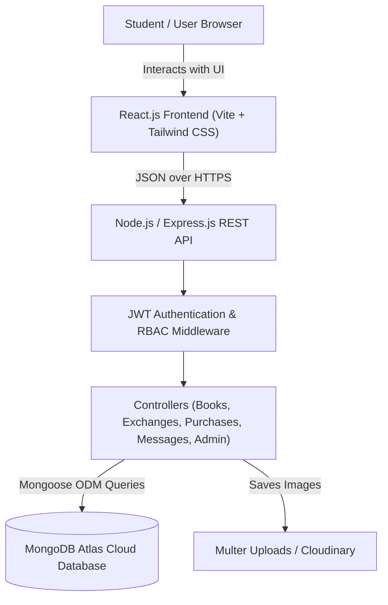

# 📚 BookLoop – Smart Book Exchange & Marketplace Platform

> **Give Books a Second Life – Read More. Spend Less. Share Knowledge.**

[](https://react.dev)
[](https://nodejs.org)
[](https://www.mongodb.com/atlas)
[](LICENSE)

---

## 1. Project Description
**BookLoop** is a modern, student-centric full-stack MERN (MongoDB, Express.js, React.js, Node.js) web platform designed to empower college students and book lovers to **buy, sell, exchange, and donate used textbooks**. 

By directly connecting students within the same university and across neighboring campuses, BookLoop eliminates extortionate bookstore buyback markups, drastically reduces student semester expenses, prevents paper waste, and nurtures an active campus sharing community.

---

## 2. Problem Statement
Every academic term, university students spend upwards of \$800–\$1,200 on expensive course textbooks. At the end of the term:
- **Traditional Bookstore Inequity:** College bookstores buy back books for less than 15% of the retail price and resell them to the next cohort at an 80% markup.
- **Environmental Waste:** Millions of heavy textbooks end up discarded in campus dumpsters, wasting precious resources and paper.
- **Unsafe & Cluttered Alternatives:** General classifieds (Craigslist, Facebook Marketplace) are filled with spam, lack textbook-specific course metadata, and are inconvenient or unsafe for student campus pickups.

---

## 3. Project Objectives
1. **Financial Relief:** Reduce student semester course material expenses by up to 80% through peer-to-peer textbook trades and direct student pricing.
2. **Environmental Sustainability:** Encourage textbook circularity and reuse, saving trees and water.
3. **Safe Campus Network:** Foster safe campus exchanges at well-lit university landmarks (libraries, student centers).
4. **Accessible Gifting:** Provide a zero-cost donation pipeline where seniors can pass textbooks down to incoming freshmen for free.

---

## 4. Key Features & Highlights

### 🎯 Marketplace & Explore Engine
- **Live Search & Filter:** Search by book title, author, course code, or ISBN with immediate results.
- **Multi-Dimensional Filters:** Filter by academic category, listing intent (Sell, Exchange, Free Donation), book condition, college campus, and price range.
- **Sorting Options:** Sort by Latest Additions, Price (Low to High / High to Low), and Most Viewed.

### 🔄 Book Swap / Exchange Workflow
- Propose a trade directly from a book details page.
- Select from your own active book listings to offer in exchange.
- Automated validation rules:
  - Prevents users from exchanging their own books.
  - Prevents duplicate pending trade proposals.
  - Automatic inventory availability updates upon completion (`available` ➔ `exchanged`).

### 💰 Direct Purchase Inquiries
- Counter-offer or request to buy directly at fair student prices.
- Transparent transaction statuses: `Pending` ➔ `Accepted` ➔ `Completed` / `Rejected` / `Cancelled`.
- Automatic inventory status marking upon completion (`available` ➔ `sold`).

### 🎁 Free Book Donations Program
- Dedicated zero-dollar ($0) textbook section.
- Live campus impact counter (Total books gifted, estimated student dollars saved).
- "Claim Donated Book" flow with intended academic purpose.

### 💬 Campus Coordination Chat
- Real-time conversation threads between buyer and seller with linked textbook preview card.
- Quick suggested prompts (*"Is this still available?"*, *"Can we meet at the campus library?"*).
- Timestamping, unread message indicators, and message history persistence.

### 🌟 Verified Review & Rating System
- 1-to-5 star rating and written reviews.
- **Strict Anti-Fraud Guardrail:** Reviews are permitted **only after a transaction is marked completed**, preventing fake reviews.
- Average rating display and seller reputation transparency.

### 📊 Personalized Student Dashboard
- High-level metrics: Total uploaded books, active listings, exchange requests received, purchase requests received, and saved wishlist count.
- **Recharts Analytics:** Weekly student activity bar charts and portfolio distribution pie charts.
- Tabs for My Listed Books, Exchange Proposals, Purchase Requests, Saved Wishlist, Transaction History, and Profile Settings.

### 🛡️ Role-Based Administrator Portal
- System overview metrics and aggregate campus textbook savings.
- Comprehensive user directory with 1-click role toggles (`student` ↔ `admin`).
- Book listings moderation (feature spotlighting or removal of policy violations).
- Live transaction oversight monitoring all trades and purchases.

---

## 5. Technology Stack

| Layer | Technologies |
|---|---|
| **Frontend** | React.js 18, Vite, Tailwind CSS, React Router DOM v6, Axios, Lucide React icons, Recharts |
| **Backend** | Node.js, Express.js, REST API Architecture, JWT, bcrypt.js, Multer, Morgan, Express Rate Limit |
| **Database** | MongoDB Atlas with Mongoose ODM (includes embedded offline fallback store) |
| **Storage** | Local disk storage (`server/uploads/`) with optional Cloudinary cloud storage |
| **Deployment** | Vercel (Frontend), Render (Backend), MongoDB Atlas (Database) |

---

## 6. System Architecture



---

## 7. Folder Structure

```
Book-Loop/
├── client/                     # Frontend React.js Application
│   ├── public/
│   ├── src/
│   │   ├── assets/             # Media and static assets
│   │   ├── components/         # Reusable UI components (Navbar, Footer, BookCard, Skeleton)
│   │   ├── context/            # Global state (AuthContext, ToastContext)
│   │   ├── pages/              # Application pages (Landing, Explore, Details, Dashboard, etc.)
│   │   ├── services/           # Axios HTTP client configuration
│   │   ├── App.jsx             # Root routing layout
│   │   ├── main.jsx            # Entry point
│   │   └── index.css           # Tailwind CSS directives
│   ├── index.html
│   ├── tailwind.config.js
│   ├── vite.config.js
│   └── vercel.json             # Vercel SPA routing rewrites
│
├── server/                     # Backend Node.js & Express API
│   ├── config/                 # Database configuration (db.js)
│   ├── controllers/            # Controller logic (Auth, Books, Exchanges, Purchases, etc.)
│   ├── middleware/             # Auth, role check, upload, error handler
│   ├── models/                 # Mongoose schema models (User, Book, ExchangeRequest, etc.)
│   ├── routes/                 # Express route definitions
│   ├── tests/                  # Integration test suite (api.test.js)
│   ├── utils/                  # Mock/Fallback storage & seed script (seedData.js)
│   ├── uploads/                # Local uploaded book cover images
│   ├── app.js                  # Express application setup
│   └── server.js               # HTTP server entrypoint
│
├── docs/                       # Comprehensive documentation
│   ├── architecture.md         # Full system architecture specification
│   ├── api-documentation.md    # Complete API endpoint reference
│   ├── database-design.md      # Database schemas & ER diagram
│   └── presentation-outline.md # 10-slide academic defense presentation outline
│
├── .env.example                # Sample environment variables
├── .gitignore
├── render.yaml                 # Render backend deployment configuration
├── package.json                # Root automation scripts
└── README.md                   # Project overview & documentation
```

---

## 8. Database Collections

- `users`: User profiles, credentials (bcrypt), role, college, registration number.
- `books`: Textbook listings, condition, category, price, images, availability status.
- `exchangerequests`: Proposed trades matching two textbooks between students.
- `purchaserequests`: Direct purchase counter-proposals and cash meetup requests.
- `wishlists`: User saved books for fast retrieval.
- `reviews`: Verified post-transaction 1-5 star ratings and comments.
- `messages` & `conversations`: Buyer-seller chat history with context book metadata.

---

## 9. Installation & Local Execution

### Prerequisites
- [Node.js](https://nodejs.org/) v18 or higher
- [npm](https://www.npmjs.com/) v9 or higher
- Optional: Local MongoDB or free [MongoDB Atlas](https://www.mongodb.com/atlas) connection URI

### Step 1: Clone Repository
```bash
git clone https://github.com/your-username/bookloop.git
cd bookloop
```

### Step 2: Configure Environment Variables
Copy `.env.example` into `server/.env`:
```bash
# In server/.env:
NODE_ENV=development
PORT=5000
MONGODB_URI=mongodb://127.0.0.1:27017/bookloop
JWT_SECRET=your_super_secret_jwt_key_2026
JWT_EXPIRE=30d
CLIENT_URL=http://localhost:5173
```

*(Note: If a live MongoDB database is not detected, BookLoop automatically utilizes its embedded persistent fallback storage with zero configuration required!)*

### Step 3: Install Dependencies
```bash
# Install backend dependencies
cd server
npm install

# Install frontend dependencies
cd ../client
npm install
```

### Step 4: Run Database Seed (Demo Data)
```bash
cd ../server
npm run seed
```
**Demo Accounts Ready for Testing:**
- 🎓 **Student 1 (Alex):** `alex@student.edu` | `password123`
- 🎓 **Student 2 (Samantha):** `samantha@student.edu` | `password123`
- 🎓 **Student 3 (Marcus):** `marcus@student.edu` | `password123`
- 🛡️ **Administrator:** `admin@bookloop.org` | `password123`

### Step 5: Start the Application

Open two terminal windows:

**Terminal 1 (Backend Server):**
```bash
cd server
npm start
# Server runs at http://localhost:5000
```

**Terminal 2 (Frontend Client):**
```bash
cd client
npm run dev
# Frontend runs at http://localhost:5173
```

---

## 10. Automated Integration Testing
To execute the comprehensive automated end-to-end integration test suite covering all authentication, book listings, exchange proposals, purchase workflows, wishlist actions, reviews, and admin endpoints:

```bash
cd server
npm test
```
*Result: 14/14 automated integration tests passing.*

---

## 11. Production Deployment Guide

### Frontend Deployment on Vercel
1. Push project to your GitHub repository.
2. Sign in to [Vercel](https://vercel.com/) and click **Add New Project**.
3. Select the repository and set the **Root Directory** to `client`.
4. Build Command: `npm run build` | Output Directory: `dist`.
5. Add Environment Variable:
   - `VITE_API_URL`: `https://your-backend.onrender.com/api`
6. Click **Deploy**. Vercel will automatically read `client/vercel.json` for SPA routing.

### Backend Deployment on Render
1. Sign in to [Render](https://render.com/) and click **New Web Service**.
2. Connect your GitHub repository.
3. Configure settings:
   - **Root Directory:** `server`
   - **Environment:** Node
   - **Build Command:** `npm install`
   - **Start Command:** `node server.js`
4. Add Environment Variables:
   - `NODE_ENV`: `production`
   - `MONGODB_URI`: `mongodb+srv://<username>:<password>@cluster0.mongodb.net/bookloop?retryWrites=true&w=majority`
   - `JWT_SECRET`: `<generate-a-strong-random-key>`
   - `CLIENT_URL`: `https://your-bookloop-app.vercel.app`
5. Click **Create Web Service**.

---

## 12. Project Defense & Team Details

| Role | Name | Registration / Roll No. | Contribution |
|---|---|---|---|
| **Full-Stack Developer** | `[Team Member 1 Name]` | `[Reg No. 1]` | System Architecture & React Frontend |
| **Backend & Database** | `[Team Member 2 Name]` | `[Reg No. 2]` | REST APIs, Auth, & Mongoose Models |
| **UI/UX & Testing** | `[Team Member 3 Name]` | `[Reg No. 3]` | Tailwind Design System & Testing |

- **Academic Supervisor:** `[Supervisor Name]`
- **Institution:** `[University / College Name]`
- **Semester / Year:** `[Semester / Academic Year]`

---

## 13. License
This project is open-source and distributed under the [MIT License](LICENSE).
