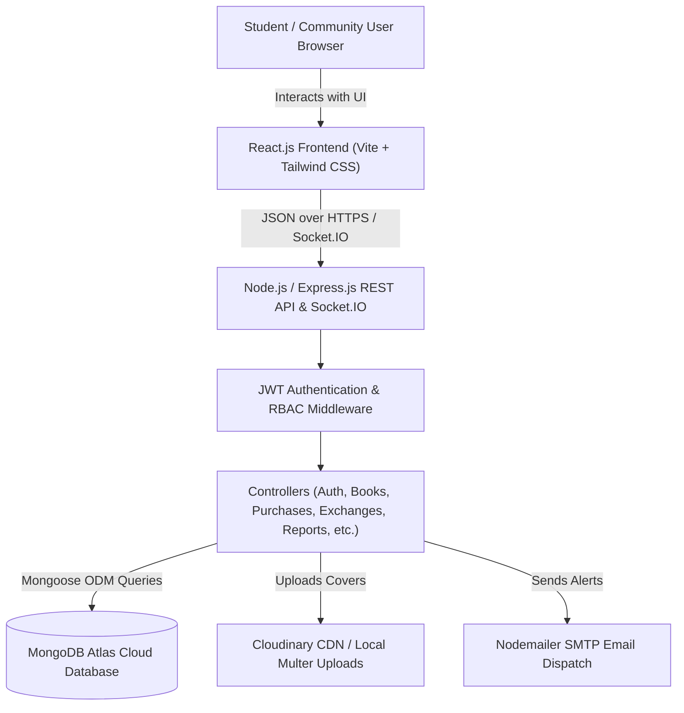

# 📚 BookLoop – Smart Book Exchange & Marketplace Platform

> **Give Books a Second Life – Read More. Spend Less. Share Knowledge.**

[](https://react.dev)
[](https://nodejs.org)
[](https://www.mongodb.com/atlas)
[](https://socket.io)
[](https://cloudinary.com)
[](LICENSE)

---

## 1. Project Description
**BookLoop** is a production-grade, student-centric full-stack MERN (MongoDB, Express.js, React.js, Node.js) web application designed to empower college students and book lovers to **buy, sell, exchange, and donate used books**.

By directly connecting students within the same university and across neighboring campuses, BookLoop eliminates extortionate bookstore buyback markups, drastically reduces student semester expenses, prevents paper waste, and nurtures a trusted campus sharing community.

---

## 2. Problem Statement & Mission
Every academic term, university students spend upwards of \$800–\$1,200 on expensive course textbooks. At the end of the term:
- **Traditional Bookstore Inequity:** College bookstores buy back books for less than 15% of the retail price and resell them to the next cohort at an 80% markup.
- **Environmental Waste:** Millions of heavy textbooks end up discarded in campus dumpsters, wasting precious resources and paper.
- **Unsafe & Cluttered Alternatives:** General classifieds (Craigslist, Facebook Marketplace) are filled with spam, lack textbook-specific course metadata, and are inconvenient or unsafe for student campus pickups.

**BookLoop Mission:** Enable direct peer-to-peer textbook circularity where every book gets a second life, students save hundreds of dollars, and campus knowledge is shared freely.

---

## 3. Technology Stack

| Layer | Technologies |
|---|---|
| **Frontend** | React.js 18, Vite, Tailwind CSS, React Router DOM v6, Axios, Lucide React icons, Recharts |
| **Backend** | Node.js, Express.js, REST API Architecture, Socket.IO, JWT, bcrypt.js, Multer, Morgan, Express Rate Limit |
| **Database** | MongoDB Atlas with Mongoose ODM (includes embedded offline persistent fallback storage) |
| **Cloud Services** | Cloudinary (permanent image CDN), Nodemailer (SMTP transactional email dispatch) |
| **Deployment** | Vercel (Frontend Single Page Application), Render (Backend Node API), MongoDB Atlas |

---

## 4. Key Real-World Features

### 🎯 Marketplace & Explore Engine
- **Live Search & Filter:** Search by book title, author, course code, or ISBN with immediate responsive results.
- **Multi-Dimensional Filters:** Filter by academic category, listing intent (Sell, Exchange, Free Donation), book condition, college campus, and price range.
- **Sorting Options:** Sort by Latest Additions, Price (Low to High / High to Low), and Most Viewed.

### 🔄 Book Swap / Exchange Workflow
- Propose a trade directly from any book details page.
- Select from your own active book listings to offer in exchange.
- Automated validation rules:
  - Prevents users from exchanging their own books.
  - Prevents duplicate pending trade proposals.
  - Automated inventory availability updates upon completion (`available` ➔ `exchanged`).

### 💰 Direct Purchase Inquiries
- Counter-offer or request to buy directly at fair student prices.
- Transparent transaction statuses: `Pending` ➔ `Accepted` ➔ `Completed` / `Rejected` / `Cancelled`.
- Conflict prevention: Accepting one buyer puts the book into `in-transaction` and declines competing proposals.
- Automatic inventory status marking upon completion (`available` ➔ `sold`).

### 🎁 Free Book Donations Program
- Dedicated zero-dollar ($0) textbook donation section.
- Structured donation request modal with academic purpose explanation.
- Real-time campus impact counter (Total books gifted, estimated student dollars saved).

### 🔔 Live In-App Notifications & Email Alerts
- Real-time notification drawer with live unread count badge.
- Instant alerts on new purchase requests, exchange proposals, direct chat messages, and transaction updates.
- Background Nodemailer SMTP email notifications sent for critical account events.

### 💬 Campus Coordination Chat
- Real-time conversation threads between buyer and seller with linked textbook preview card.
- Quick suggested prompts (*"Is this still available?"*, *"Can we meet at the campus library?"*).
- Timestamping, unread message indicators, and message history persistence.

### 🌟 Verified Review & Rating System
- 1-to-5 star rating and written reviews.
- **Strict Anti-Fraud Guardrail:** Reviews are permitted **only after a transaction is marked completed**, preventing fake reviews.
- Average rating display and seller reputation transparency.

### 🛡️ Community Safety, Moderation & Admin Control
- **Content Reporting:** Students can report fraudulent listings, suspicious sellers, or inappropriate books directly to moderators.
- **Admin Moderation Queue:** Review, resolve, or dismiss reported listings with resolution notes.
- **User Suspension:** Administrators can suspend malicious users (blocking login with 403 Forbidden) or permanently delete accounts.
- **Password Reset:** Secure cryptographically random reset tokens with 10-minute expiry and email recovery links.

---

## 5. System Architecture & Component Diagram



---

## 6. Project Structure

```
Book-Loop/
├── client/                     # Frontend React.js Application
│   ├── public/                 # Static public files
│   ├── src/
│   │   ├── assets/             # Media and static assets
│   │   ├── components/         # Reusable UI components (Navbar, Footer, BookCard, Skeleton, etc.)
│   │   ├── context/            # Global state (AuthContext, ToastContext)
│   │   ├── pages/              # Application pages (Landing, Explore, Details, Dashboard, Admin, etc.)
│   │   ├── services/           # Axios HTTP client configuration
│   │   ├── App.jsx             # Main router
│   │   ├── main.jsx            # React root entrypoint
│   │   └── index.css           # Tailwind CSS directives
│   ├── .env.example            # Client environment template
│   ├── index.html
│   ├── tailwind.config.js
│   ├── vite.config.js
│   └── vercel.json             # Vercel SPA routing rewrites
│
├── server/                     # Backend Node.js & Express API
│   ├── config/                 # Database configuration (db.js)
│   ├── controllers/            # Controller logic (Auth, Books, Exchanges, Purchases, Notifications, Reports)
│   ├── middleware/             # Auth, role check, upload, rate-limit, error handler
│   ├── models/                 # Mongoose schema models (11 data models)
│   ├── routes/                 # Express route definitions
│   ├── tests/                  # Automated verification test suites
│   │   ├── api.test.js         # Core integration tests
│   │   └── e2e-user-flows.test.js # Multi-user scenarios 1-5
│   ├── utils/                  # Cloudinary, Email, Notifications, FallbackDb, Seed script
│   ├── uploads/                # Local uploaded book cover images
│   ├── .env.example            # Server environment template
│   ├── app.js                  # Express application setup
│   └── server.js               # HTTP server & Socket.IO entrypoint
│
├── render.yaml                 # Render backend deployment configuration
├── package.json                # Root automation scripts
└── README.md                   # Project overview & documentation
```

---

## 7. Complete REST API Reference

| Endpoint | Method | Access | Description |
|---|---|---|---|
| **Authentication & Profiles** | | | |
| `/api/auth/register` | `POST` | Public | Register student account |
| `/api/auth/login` | `POST` | Public | Sign in and receive JWT token |
| `/api/auth/forgotpassword` | `POST` | Public | Request password reset token |
| `/api/auth/resetpassword/:token`| `PUT` | Public | Reset password using valid token |
| `/api/auth/me` | `GET` | Private | Retrieve authenticated user profile |
| `/api/auth/profile` | `PUT` | Private | Update student profile information |
| **Book Listings** | | | |
| `/api/books` | `GET` | Public | Search and filter catalog with pagination |
| `/api/books/:id` | `GET` | Public | Retrieve full book details & seller reviews |
| `/api/books` | `POST` | Private | Upload and publish a new book listing |
| `/api/books/:id` | `PUT` | Private | Edit owned book listing |
| `/api/books/:id` | `DELETE` | Private | Remove owned book listing |
| `/api/books/my/listings` | `GET` | Private | Retrieve logged-in student's listings |
| `/api/books/upload-image` | `POST` | Private | Upload image file (Cloudinary/Multer) |
| **Exchanges & Swaps** | | | |
| `/api/exchanges` | `POST` | Private | Propose a book trade to an owner |
| `/api/exchanges/received` | `GET` | Private | View incoming exchange proposals |
| `/api/exchanges/sent` | `GET` | Private | View outgoing exchange proposals |
| `/api/exchanges/:id/status` | `PUT` | Private | Accept, decline, or complete trade |
| **Purchases & Orders** | | | |
| `/api/purchases` | `POST` | Private | Submit purchase offer to seller |
| `/api/purchases/received` | `GET` | Private | View received purchase inquiries |
| `/api/purchases/sent` | `GET` | Private | View sent purchase requests |
| `/api/purchases/:id/status` | `PUT` | Private | Accept, complete, or reject purchase |
| **Free Donations** | | | |
| `/api/donations` | `GET` | Public | Browse free donated textbooks catalog |
| `/api/donations/request` | `POST` | Private | Claim a donated book with academic purpose |
| `/api/donations/stats` | `GET` | Public | Retrieve community donation impact metrics |
| **Real-Time Messages** | | | |
| `/api/messages` | `POST` | Private | Send a direct message linked to book |
| `/api/messages/:conversationId` | `GET` | Private | Fetch message history for conversation |
| `/api/messages/conversations/all`| `GET` | Private | List active user conversation threads |
| **Wishlist & Reviews** | | | |
| `/api/wishlist` | `GET` | Private | Fetch student's saved books |
| `/api/wishlist/:bookId` | `POST` | Private | Toggle book saved in wishlist |
| `/api/reviews` | `POST` | Private | Submit 1-5 star review after completion |
| `/api/reviews/user/:userId` | `GET` | Public | Get aggregate rating and user reviews |
| **In-App Notifications** | | | |
| `/api/notifications` | `GET` | Private | Fetch notifications & unread count |
| `/api/notifications/:id/read` | `PUT` | Private | Mark notification as read |
| `/api/notifications/read-all` | `PUT` | Private | Mark all notifications as read |
| **Safety & Moderation** | | | |
| `/api/reports` | `POST` | Private | Submit report on inappropriate listing/user |
| `/api/reports` | `GET` | Admin | Review moderation reports queue |
| `/api/reports/:id/status` | `PUT` | Admin | Resolve or dismiss report |
| `/api/admin/users/:id/suspend` | `PUT` | Admin | Toggle user suspension |
| `/api/admin/users/:id` | `DELETE` | Admin | Permanently delete user |
| `/api/admin/statistics` | `GET` | Admin | High-level platform metrics & charts |

---

## 8. Installation & Local Setup

### Prerequisites
- [Node.js](https://nodejs.org/) v18+ 
- [npm](https://www.npmjs.com/) v9+
- Optional: Local MongoDB or free [MongoDB Atlas](https://www.mongodb.com/atlas) connection URI

### Step 1: Clone Repository
```bash
git clone https://github.com/your-username/bookloop.git
cd bookloop
```

### Step 2: Configure Environment Variables
Copy `.env.example` into `server/.env`:
```bash
# In server/.env:
PORT=5000
NODE_ENV=development
MONGO_URI=mongodb://127.0.0.1:27017/bookloop
JWT_SECRET=your_super_secret_jwt_key_min_32_characters
JWT_EXPIRE=30d
CLIENT_URL=http://localhost:5173
```
*(Note: If a live MongoDB database is not detected, BookLoop automatically utilizes its embedded persistent fallback storage with zero configuration required!)*

### Step 3: Install Dependencies
```bash
# Install backend dependencies
cd server
npm install

# Install frontend dependencies
cd ../client
npm install
```

### Step 4: Seed Database with Sample Books
```bash
cd ../server
npm run seed
```

**1-Click Fast Login Demo Accounts:**
- 🎓 **Student 1 (Alex):** `alex@student.edu` | `password123`
- 🎓 **Student 2 (Samantha):** `samantha@student.edu` | `password123`
- 🎓 **Student 3 (Marcus):** `marcus@student.edu` | `password123`
- 🛡️ **Administrator:** `admin@bookloop.org` | `password123`

### Step 5: Start Development Servers

Open two terminal windows:

**Terminal 1 (Backend API & Socket.IO):**
```bash
cd server
npm start
# Server runs at http://localhost:5000
```

**Terminal 2 (Frontend Client):**
```bash
cd client
npm run dev
# Frontend runs at http://localhost:5173
```

---

## 9. Automated Testing & Verification

BookLoop includes two automated test suites covering all 22 project criteria and all 5 multi-user end-to-end scenarios:

```bash
cd server
npm test
```

### Verification Suites Executed:
1. `tests/api.test.js` (14 Core Integration Tests):
   - Health checks, authentication, listings, exchange proposals, purchases, messaging, donation requests, admin metrics.
2. `tests/e2e-user-flows.test.js` (27 End-to-End Multi-User Scenarios):
   - **Scenario 1:** User A registers & uploads Java book ➔ User B searches, wishlists, sends purchase request & chat ➔ User A receives in-app notification, accepts request, replies ➔ Marks completed ➔ User B submits verified 5-star review.
   - **Scenario 2:** User A lists Algorithms book ➔ User B proposes AI textbook ➔ User A reviews, accepts & completes exchange (both marked exchanged).
   - **Scenario 3:** User A lists free Calculus book ➔ User B claims with purpose ➔ Donation processed.
   - **Scenario 4:** Community safety report submitted ➔ Admin inspects & resolves ➔ Admin suspends user (blocks login with 403) ➔ Admin reactivates user.
   - **Scenario 5:** Forgot password token generation ➔ Password reset ➔ Successful login with new password.

**Result: 41/41 Automated Tests Passing (100% Success Rate).**

---

## 10. Public Production Deployment Guide

### Frontend Deployment on Vercel
1. Push project to your GitHub repository.
2. Sign in to [Vercel](https://vercel.com/) and click **Add New Project**.
3. Select the repository and set the **Root Directory** to `client`.
4. Build Command: `npm run build` | Output Directory: `dist`.
5. Add Environment Variable:
   - `VITE_API_URL`: `https://your-backend.onrender.com/api`
6. Click **Deploy**. Vercel will automatically read `client/vercel.json` for SPA routing.

### Backend Deployment on Render
1. Sign in to [Render](https://render.com/) and click **New Web Service**.
2. Connect your GitHub repository.
3. Configure settings:
   - **Root Directory:** `server`
   - **Environment:** Node
   - **Build Command:** `npm install`
   - **Start Command:** `node server.js`
4. Add Environment Variables:
   - `NODE_ENV`: `production`
   - `MONGO_URI`: `mongodb+srv://<username>:<password>@cluster0.mongodb.net/bookloop?retryWrites=true&w=majority`
   - `JWT_SECRET`: `<generate-a-strong-random-key>`
   - `CLIENT_URL`: `https://your-bookloop-app.vercel.app`
   - *(Optional)* `CLOUDINARY_CLOUD_NAME`, `CLOUDINARY_API_KEY`, `CLOUDINARY_API_SECRET`
   - *(Optional)* `SMTP_HOST`, `SMTP_PORT`, `SMTP_USER`, `SMTP_PASS`
5. Click **Create Web Service**.

---

## 11. License
This project is open-source and distributed under the [MIT License](LICENSE).
