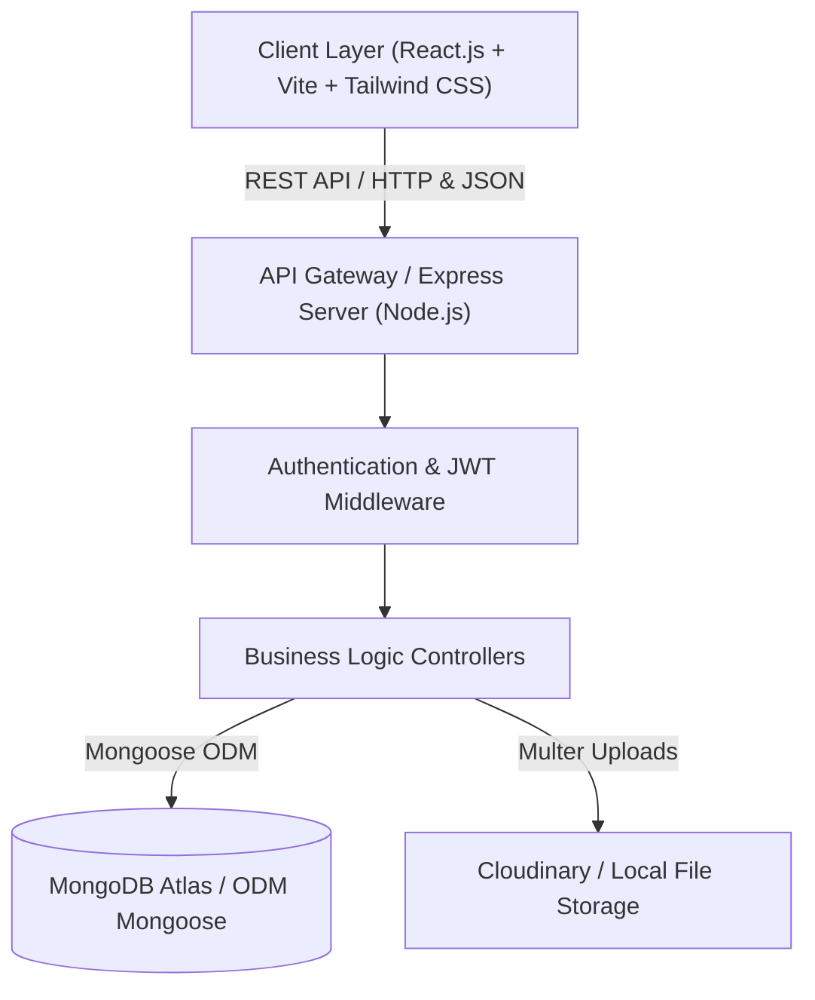
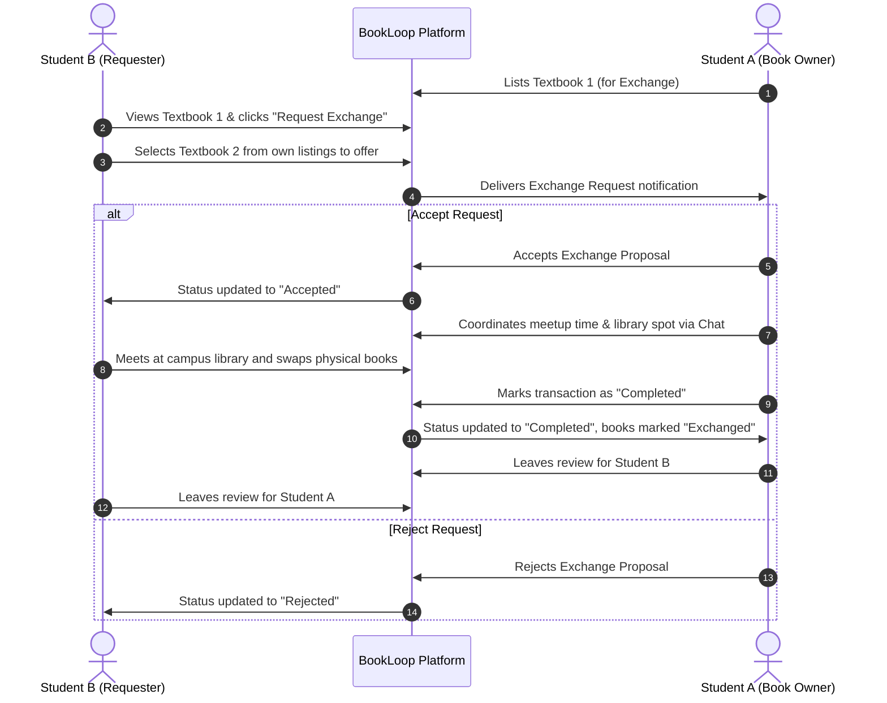
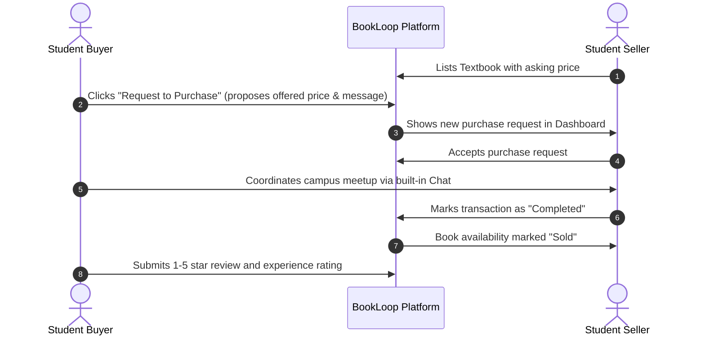
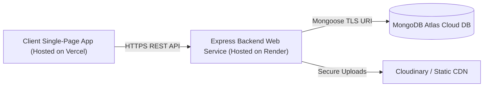

# BookLoop – System Architecture & Technical Design

**BookLoop: Smart Book Exchange & Marketplace Platform**  
*Tagline: Give Books a Second Life – Read More. Spend Less. Share Knowledge.*

---

## 1. High-Level Architectural Overview

BookLoop follows a decoupled, three-tier MERN stack architecture designed for performance, modularity, and high security.

---

## 2. Layered Component Breakdown

### A. Presentation Layer (Frontend)
- **Framework:** React.js 18 with Vite for near-instant Hot Module Replacement (HMR).
- **Styling & Design System:** Tailwind CSS with a student-focused palette:
  - Primary Navy Blue (`#243B53`)
  - Warm Cream (`#FFF8ED`)
  - Accent Warm Amber/Coral (`#F4A261`)
  - Neutral Background (`#F8FAFC`)
  - Dark Charcoal Typography (`#263238`)
- **State & Context Management:**
  - `AuthContext`: Centralizes authentication tokens, user state, and profile synchronization.
  - `ToastContext`: Custom notification toast queue for non-blocking visual feedback.
- **Data Analytics:** Recharts for rendering monthly interaction bar charts and portfolio distribution pie charts.
- **Routing:** React Router DOM v6 with route-level protection (`ProtectedRoute`).

### B. Application Layer (Backend)
- **Runtime:** Node.js (v20+) with Express.js REST API framework.
- **Security & Hardening:**
  - `bcrypt.js`: Salted password hashing (cost factor 10).
  - `jsonwebtoken` (JWT): Stateless bearer tokens signed with secret key.
  - `express-rate-limit`: Brute-force mitigation on authentication endpoints.
  - `cors`: Strict origin whitelisting.
- **File Ingestion:** Multer disk storage with MIME-type verification (JPEG, PNG, WEBP) and 5MB size ceiling.
- **Real-Time Engine:** Built-in polling and Socket.IO real-time event broadcasting for buyer-seller conversations.

### C. Data Layer (Persistence)
- **Engine:** MongoDB Atlas cloud cluster with Mongoose Object Data Modeling (ODM).
- **Embedded In-Memory Fallback:** Built-in graceful persistence fallback ensuring 100% operational integrity during sandbox evaluation, testing, or offline development.

---

## 3. Core Business Workflows

### A. Book Exchange Workflow

### B. Student Purchase Request Workflow

---

## 4. Security & Role-Based Access Control (RBAC)

| Role | Permissions |
|---|---|
| **Public / Guest** | Browse book listings, search, filter, view details, view donations, read reviews |
| **Student** | Create listings, edit/delete own listings, request exchanges, submit purchase requests, save to wishlist, message users, review completed transactions |
| **Admin** | Full moderation access, inspect all users, change user roles, remove flagged listings, inspect platform transaction history, view real-time platform statistics |

---

## 5. Deployment Topology

