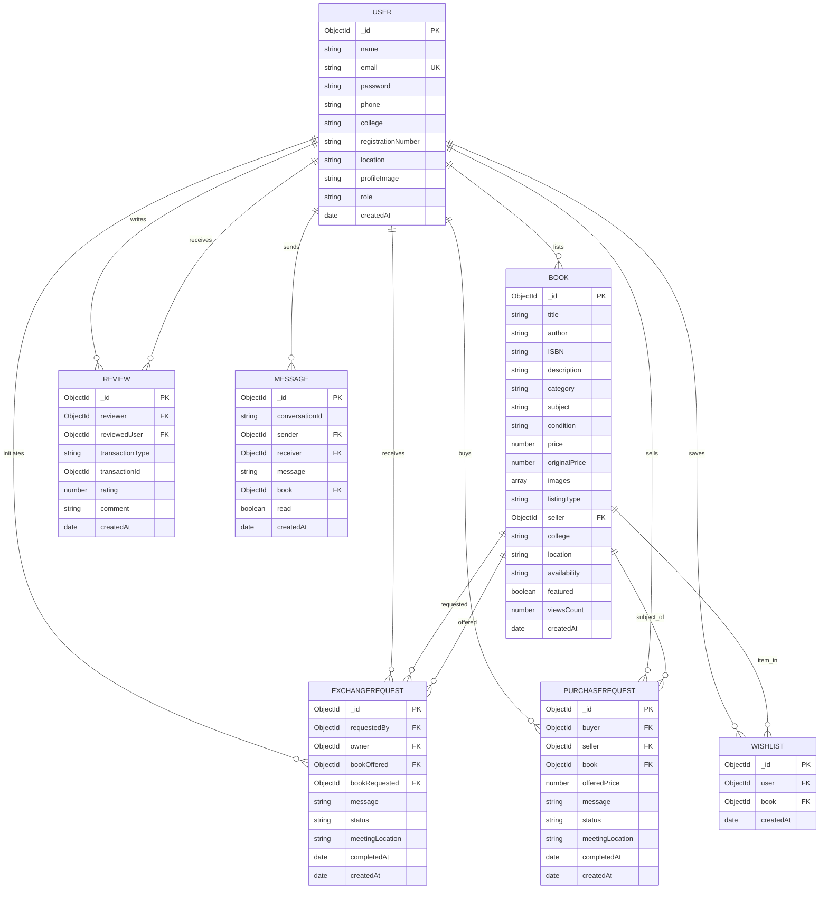

# BookLoop – Database Design & Schema Specification

**Database Engine:** MongoDB Atlas (Mongoose ODM)

---

## 1. Entity-Relationship (ER) Diagram

---

## 2. Collections & Field Specifications

### 2.1 User Collection (`users`)
- **Indexes:**
  - `{ email: 1 }` (Unique, Lowercase)
  - `{ college: 1 }`
- **Security:**
  - Password hashed using bcrypt before insertion (`pre('save')`).
  - Passwords excluded by default from queries (`select: false`).

### 2.2 Book Collection (`books`)
- **Indexes:**
  - Text Search: `{ title: 'text', author: 'text', subject: 'text', description: 'text' }`
  - Filter Index: `{ category: 1, listingType: 1, college: 1, availability: 1 }`
- **Validation:**
  - `listingType`: enum `['Sell', 'Exchange', 'Donate']`
  - `condition`: enum `['Like New', 'Good', 'Fair', 'Poor']`
  - `availability`: enum `['available', 'pending', 'exchanged', 'sold', 'donated']`
  - `price`: min 0 (auto-enforced as 0 when `listingType === 'Donate'`).

### 2.3 ExchangeRequest Collection (`exchangerequests`)
- **Indexes:**
  - `{ requestedBy: 1, bookRequested: 1, status: 1 }`
  - `{ owner: 1, status: 1 }`
- **Integrity Rule:**
  - Prevent duplicate requests for the same book pair while previous is pending.
  - Reject requests where `requestedBy === owner`.

### 2.4 PurchaseRequest Collection (`purchaserequests`)
- **Indexes:**
  - `{ buyer: 1, book: 1, status: 1 }`
  - `{ seller: 1, status: 1 }`
- **Integrity Rule:**
  - Reject purchases where `buyer === seller`.

### 2.5 Wishlist Collection (`wishlists`)
- **Indexes:**
  - `{ user: 1, book: 1 }` (Unique compound index preventing duplicates).

### 2.6 Review Collection (`reviews`)
- **Indexes:**
  - `{ reviewer: 1, transactionId: 1 }` (Unique: prevents duplicate reviews per transaction).
  - `{ reviewedUser: 1, rating: 1 }` (Fast rating aggregation).
- **Integrity Rule:**
  - `rating`: min 1, max 5.
  - Review only created after matching transaction has `status === 'completed'`.
